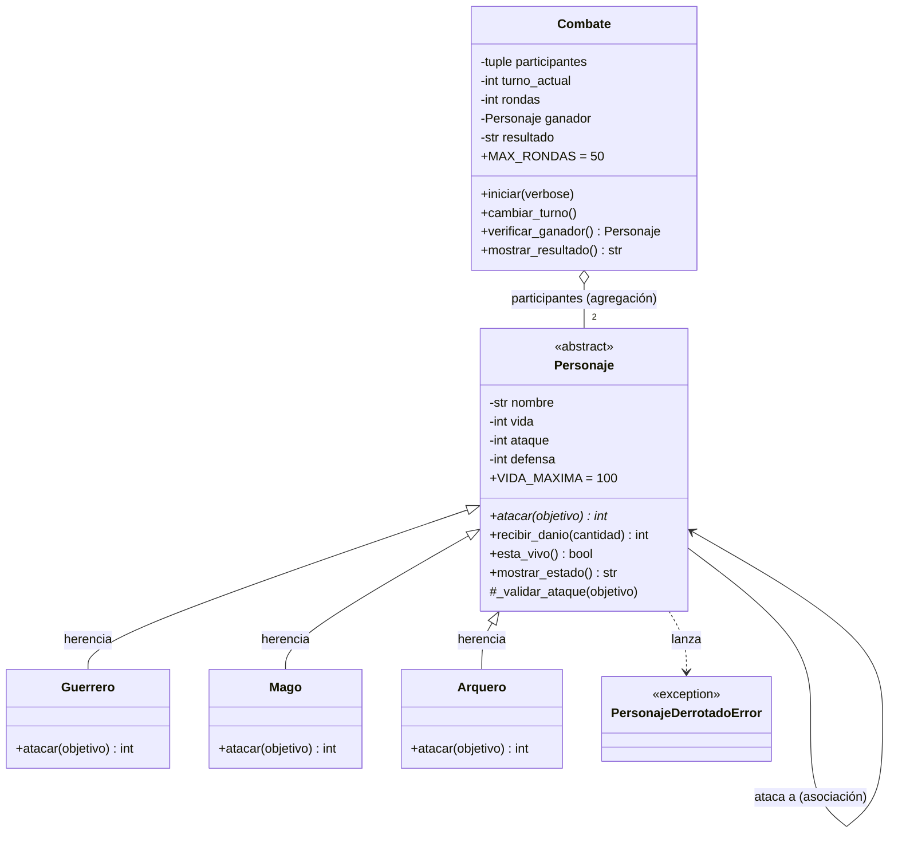

# Guardians of the Ancient Kingdom

Sistema de combate por turnos en Python, desarrollado con Programación Orientada a Objetos.

**Autor:** Aly Jose Rivera Manotas · **Asignatura:** Programación Orientada a Objetos con Python

---

## 1. Descripción

En el reino de Eldoria existen tres órdenes de guardianes: Guerreros, Magos y Arqueros. Todos tienen nombre, vida, ataque y defensa, pero cada orden pelea de forma distinta.

El programa enfrenta a dos guardianes por turnos, aplica las reglas de combate de cada uno, actualiza la vida después de cada ataque y decide automáticamente quién gana, o si hay empate. El problema que resuelve es modelar personajes que comparten una base común pero se comportan diferente, y controlar un combate sin que el controlador necesite saber qué tipo de personaje tiene enfrente.

## 2. Estructura

```text
Guardians-of-the-Ancient-Kingdom/
├── README.md            # Esta documentación
├── main.py              # Creación de objetos, demostración y los 12 casos de prueba
├── personajes.py        # Definición de las clases (no ejecuta nada al importarse
└── test_personajes.py   # Pruebas automatizadas con Pytest (Reto extra 2)
```

- **`personajes.py`**: contiene `Personaje` (abstracta), `Guerrero`, `Mago`, `Arquero`, `Combate` y la excepción `PersonajeDerrotadoError`. Es el "cómo funciona" del sistema.
- **`main.py`**: importa las clases, crea personajes, ejecuta ataques y combates, y muestra en consola el resultado de los casos de prueba obligatorios. No repite la implementación de las clases.
- **`test_personajes.py`**: las mismas reglas verificadas de forma automática y repetible con Pytest.

## 3. Clases

| Clase | Responsabilidad |
|---|---|
| `Personaje` | Clase abstracta. Guarda y protege nombre, vida, ataque y defensa; implementa lo que es igual para todos (`recibir_danio`, `esta_vivo`, `mostrar_estado`, validaciones de ataque) y obliga a las hijas a implementar `atacar()`. |
| `Guerrero` | Implementa `atacar()` con *Golpe poderoso*: ataque +20 % antes de restar la defensa del objetivo. |
| `Mago` | Implementa `atacar()` con *Hechizo penetrante*: el daño es su ataque, ignorando la defensa. |
| `Arquero` | Implementa `atacar()` con *Disparo crítico*: si su ataque supera la defensa del objetivo, el daño base se duplica. |
| `Combate` | Administra el enfrentamiento: controla los turnos, cuenta rondas, detecta ganador o empate y presenta el resultado. No sabe nada de las habilidades específicas. |

## 4. Relaciones

- **Herencia (`Guerrero`, `Mago` y `Arquero` _son_ un `Personaje`)**: los tres comparten atributos y métodos de la clase base en lugar de repetirlos.
- **Asociación (un personaje _interactúa con_ otro)**: cuando `Arthas.atacar(gandalf)` se ejecuta, un objeto usa los métodos de otro (`gandalf.defensa`, `gandalf.recibir_danio()`). Ninguno es dueño del otro; solo se relacionan durante el ataque.
- **Agregación (un `Combate` _tiene_ participantes)**: los personajes se crean fuera del combate y se le entregan al constructor. Existen antes y siguen existiendo después, y `Combate` solo los administra.

## 5. Conceptos de POO

- **Abstracción**: `Personaje` define _qué_ puede hacer todo guardián (`atacar`) sin decir _cómo_. Al ser abstracta no puede instanciarse (el programa lo comprueba con un `TypeError`).
- **Encapsulamiento**: los atributos son privados (`__vida`, `__nombre`, …) y solo se tocan mediante propiedades (`@property` y setters) que validan: la vida debe ser un entero entre 0 y 100, el ataque positivo, la defensa no negativa y el nombre no vacío. Las excepciones son `TypeError` o `ValueError` según el caso.
- **Herencia**: `recibir_danio()`, `esta_vivo()`, `mostrar_estado()` y `_validar_ataque()` se escriben una sola vez en `Personaje` y las tres subclases las reciben gratis.
- **Polimorfismo**: dentro de `Combate.iniciar()` solo aparece `atacante.atacar(objetivo)`. Esa misma línea ejecuta un golpe poderoso, un hechizo o un disparo crítico según el objeto. Nunca se pregunta por el tipo.

## 6. Lógica del combate

**Cálculo del daño** (siempre entero, nunca negativo):

| Clase | Fórmula |
|---|---|
| Guerrero | `max(0, ataque × 1.20 − defensa del objetivo)`, redondeado hacia abajo |
| Mago | `ataque` (ignora la defensa) |
| Arquero | `(ataque − defensa) × 2` si `ataque > defensa`; si no, `0` |

El resultado se pasa a `recibir_danio()`, que **no vuelve a restar la defensa**, recorta el daño a la vida restante (la vida nunca baja de 0) y devuelve el daño efectivo. Por eso en el turno 6 del ejemplo, Gandalf calcula 40 pero Arthas solo recibe 20.

> El 20 % del Guerrero se calcula con aritmética entera (`ataque * 120 // 100`) para evitar errores de punto flotante.

**Turnos**:

1. Ataca primero el primer personaje que se entregó al `Combate`.
2. Una **ronda** son dos turnos, uno por personaje. `cambiar_turno()` alterna quién ataca.
3. Después de cada ataque se muestra el estado de ambos y se llama a `verificar_ganador()`.
4. El combate termina cuando alguien llega a 0 de vida (**victoria**), cuando una ronda completa no causa daño (**empate técnico**) o al completar **50 rondas** sin ganador (**empate por límite**).
5. Un personaje derrotado no puede atacar ni ser atacado: se lanza `PersonajeDerrotadoError`.

## 7. Ejecución

Requiere Python 3.8 o superior.

```bash
git clone https://github.com/alyriveramanotas-prog/Guardians-of-the-Ancient-Kingdom.git
cd Guardians-of-the-Ancient-Kingdom
python main.py
```

En algunos sistemas el comando es `python3 main.py`. Para las pruebas automatizadas:

```bash
pip install pytest
pytest -v
```

## 8. Pruebas

`python main.py` muestra los 12 casos obligatorios (más uno extra) y termina con un resumen. Resultado obtenido: **48 de 48 comprobaciones superadas**.

| # | Caso | Resultado |
|---|---|---|
| 1 | Creación de los tres tipos; `Personaje` no se puede instanciar | Correcto |
| 2 | Vida 101, 1000 y −1 rechazadas (`ValueError`); vida decimal rechazada (`TypeError`) | Correcto |
| 3 | Nombres `""`, `"   "` y numérico rechazados | Correcto |
| 4 | Ataque 0, −5, 3.5 y defensa −1, `"10"` rechazados; defensa 0 aceptada | Correcto |
| 5 | Guerrero: ataque 30 contra defensa 10 → daño 26; `7 × 1.2 = 8.4` → 8 | Correcto |
| 6 | Mago: ataque 40 contra defensa 20 → daño 40 | Correcto |
| 7 | Arquero: ataque 35 contra defensa 15 → daño 40; ataque ≤ defensa → daño 0 | Correcto |
| 8 | Vida 20 recibe 50 → vida 0, no −30; vida −5 y daño negativo rechazados | Correcto |
| 9 | Derrotado no puede atacar ni ser atacado; objetivo `None` rechazado | Correcto |
| 10 | Combate completo Arthas vs. Gandalf: daños 26, 40, 26, 40, 26, 20 | Correcto |
| 11 | Ganador identificado: Gandalf, con 2 de vida | Correcto |
| 12 | Dos guerreros con ataque 10 y defensa 50 → empate técnico en la ronda 1 | Correcto |
| Extra | 50 rondas sin ganador → empate por límite (vidas 50 y 50) | Correcto |

Tabla producida por el programa para el combate del enunciado (coincide con la del documento):

```text
  Turno   Atacante      Daño     Vida Arthas    Vida Gandalf
  Inicio  -                -             100              80
  1       Arthas          26             100              54
  2       Gandalf         40              60              54
  3       Arthas          26              60              28
  4       Gandalf         40              20              28
  5       Arthas          26              20               2
  6       Gandalf         20               0               2
Ganador: Gandalf [Mago] con 2 de vida tras 3 rondas (6 turnos).
```

---

# Retos extra

## Reto 1: Diagrama de clases UML

Un **diagrama de clases UML** es un plano visual de un programa orientado a objetos: muestra las clases con sus atributos y métodos, y las relaciones entre ellas (herencia, asociación, agregación). Sirve para entender y comunicar el diseño antes y después de programar. Este diagrama está escrito en Mermaid, que GitHub dibuja automáticamente.



**Cómo leerlo**: la flecha con triángulo vacío indica herencia (las tres subclases salen de `Personaje`). El rombo vacío de `Combate` indica agregación: `Combate` agrupa a dos personajes, pero ellos existen por su cuenta. La flecha simple de `Personaje` a sí misma es la asociación: un personaje usa a otro al atacar. `<<abstract>>` y el asterisco en `atacar()*` marcan la clase y el método abstractos.

## Reto 2: Pruebas automatizadas con Pytest

**Pytest** es una librería de Python para escribir pruebas como funciones que empiezan con `test_` y usan `assert`. Al ejecutarla, busca esas funciones, las corre todas y dice cuáles pasaron o fallaron. Así las reglas del sistema se comprueban solas y de forma repetible, sin revisar mensajes a ojo.

Las pruebas están en `test_personajes.py` (44 casos, contando los parametrizados) y cubren creación válida, rechazo de valores incorrectos, daño de cada clase, vida nunca negativa, derrotado que no ataca y resultado de los combates (victoria, empate técnico, límite de 50 rondas y un guardián nuevo sin modificar `Combate`).


**Resultado de la ejecución:**

44 passed

## Reto 3: Reto de abstracción

**¿Por qué `atacar()` debe ser abstracto, pero `recibir_danio()` puede estar implementado en la clase base?**

`Personaje` representa lo que todo guardián es y sabe hacer, sin ser ningún guardián en particular. Su responsabilidad es doble: guardar y proteger el estado común (nombre, vida, ataque, defensa) y ofrecer los comportamientos que no cambian de un tipo a otro.

Todos los personajes comparten el hecho de **recibir daño**, y eso funciona igual para Arthas, Gandalf o Legolas: la cantidad llega ya calculada (la defensa se aplicó en el atacante), se rechaza si es negativa, se recorta para que la vida no baje de 0 y se devuelve el daño efectivo. Ninguna de esas reglas depende de la orden del guardián. Escribirla una vez en `Personaje` evita copiarla en tres clases, donde una copia podría quedar distinta y dejar vida negativa solo en un tipo, y hace que cualquier guardián nuevo la herede sin esfuerzo. Eso es **herencia** usada para reutilizar lógica.

`atacar()` es la parte que **sí varía**. El Guerrero multiplica su ataque por 1.20 y resta la defensa, el Mago ignora la defensa y el Arquero duplica el daño cuando la supera. No existe un "ataque genérico" correcto que poner en la clase base: cualquier implementación sería arbitraria o incorrecta para dos de las tres hijas. Aun así, todos deben poder atacar para participar en un combate. Marcarlo con `@abstractmethod` expresa ese contrato: "todo `Personaje` sabe atacar, cada uno a su manera". Python hace cumplir el contrato: no se puede crear un `Personaje` ni una subclase que olvide implementarlo (las pruebas lo comprueban con un `TypeError`).

Esto conecta los tres conceptos. La **abstracción** separa el _qué_ (`atacar`) del _cómo_. La **herencia** reutiliza lo común (`recibir_danio`). El **polimorfismo** permite que `Combate` llame a `atacante.atacar(objetivo)` sin conocer el tipo: en el turno 1 del ejemplo se ejecuta el golpe poderoso de Arthas y en el turno 2 el hechizo de Gandalf, con la misma línea de código. Por eso se puede añadir un guardián nuevo (en `test_personajes.py` hay un `Paladin` de prueba) sin tocar `Combate`.

El turno 6 del ejemplo muestra las dos mitades trabajando juntas: el `Mago` calcula 40 de daño (lógica específica de `atacar`), pero `recibir_danio` de la clase base solo aplica 20 porque a Arthas le quedaban 20 puntos (lógica común).
